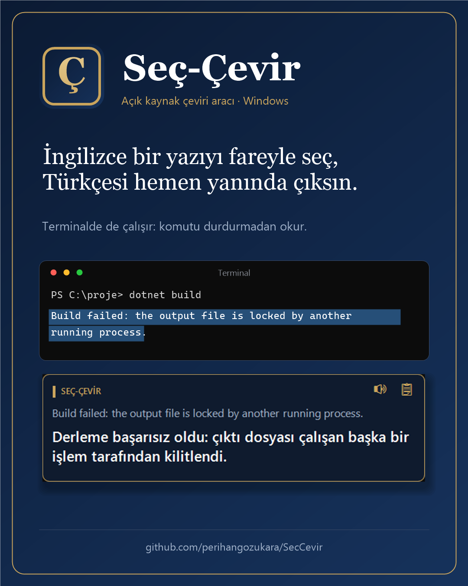
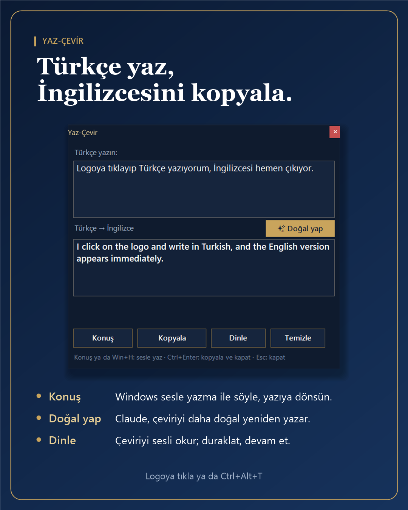

# Seç-Çevir (Select & Translate)

A small Windows tool for people reading English: select English (or other foreign-language) text with the mouse in any app, and its Turkish translation appears right under the selection. Turkish text is ignored.

  
  

## Download
Get `SecCevir.exe` from the [latest release](https://github.com/perihangozukara/SecCevir/releases/latest) and run it. No installer; it lives in the system tray.

- Needs Windows 10 or 11 (.NET Framework 4, already part of Windows).
- The exe is not code-signed, so Windows SmartScreen may warn on first run: click **More info → Run anyway**. You can also build it yourself from the source (see Build).
- ✨ Make it natural needs [Claude Code](https://claude.com/claude-code) installed and logged in; everything else works without it.

## Features

- Works in terminals too (Windows Terminal, console, Git Bash, PuTTY) without sending Ctrl+C, so running commands are never interrupted. The selection is read through UI Automation, or from the clipboard when the terminal copies on select.
- **Type & translate:** click the tray icon (or press Ctrl+Alt+T anywhere), type a Turkish sentence and get its English translation (English input is translated to Turkish). Copy button, Ctrl+Enter copies and closes, Esc closes.
- **✨ Make it natural:** in the type & translate window, asks Claude (Claude Haiku 5.5) for natural English, with a short Turkish note on what changed. If you type English, it corrects your English. It runs through the locally installed Claude Code (`claude -p`) with your existing Claude subscription login; no API key is used or passed on, so it never bills the paid API.
- The selection popup has a copy button for the Turkish translation
- Works from the system tray; can be switched on/off and set to start with Windows
- Can read the text aloud
- Single C# file, no installer

## Build
Run `derle.bat` (uses the C# compiler that ships with Windows / .NET Framework 4). It creates `SecCevir.exe`.

## Troubleshooting
The app writes skip reasons to `SecCevir.log` next to the exe (never the selected text). Create an empty `SecCevir.debug` file there for step-by-step logging.

## Privacy
The selected text is sent to Google Translate to get the translation. Do not use it on confidential text.

Built with the help of an AI coding assistant as part of my learning journey.
